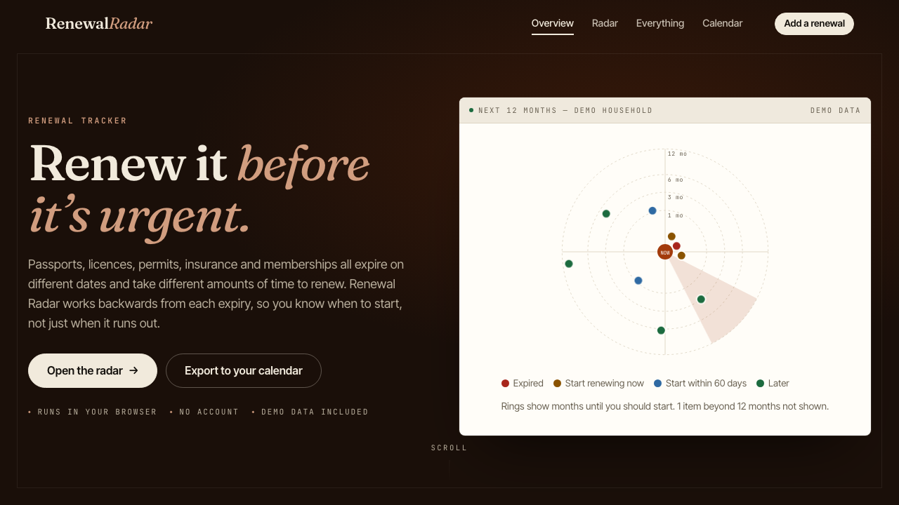
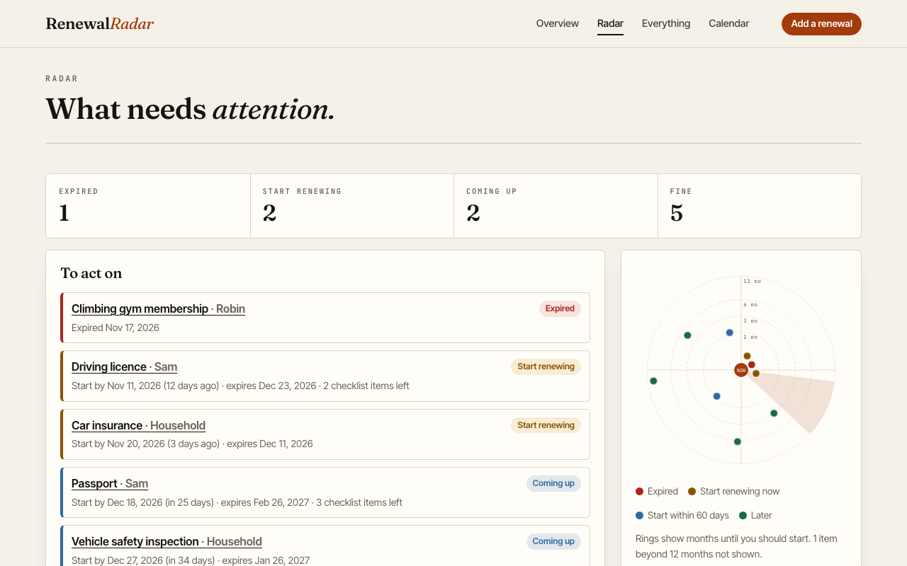
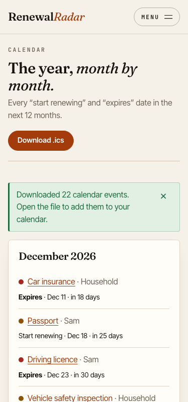

# Renewal Radar

Track documents, licences, permits, insurance and memberships that expire. Renewal Radar works back from each expiry date using a lead time, so you know when to **start** renewing, then keeps a checklist, a renewal history and a calendar export.

**Live demo:** [https://renewal-radar.vercel.app/](https://renewal-radar.vercel.app/) — runs entirely in your browser; demo data is fictional and labelled.



| Radar | Mobile calendar |
| --- | --- |
|  |  |

## Run it

```bash
npm install
npm run dev        # http://localhost:5208
npm test
npm run build
npm run test:e2e   # Playwright smoke test (npm run e2e:install once if Chromium is missing)
```

## Main workflow

1. The app opens with ten labelled **demo items** for a fictional household, covering every state (expired, start now, coming up, fine), one item beyond 12 months and one very long name. **Everything → Clear demo items** removes them.
2. **Add a renewal** → name, type, who it belongs to, reference number (masked on screen), expiry, lead time (suggested per type: e.g. passport 70 days, insurance 21) and cost. A preview shows the “start renewing by” date.
3. **Radar** → counts per status, a list of what to act on with checklist progress, and a radar where distance from the centre is time until you should start. Select a blip to open the item.
4. Open an item → reveal or hide the reference, tick and add checklist items, then **I’ve renewed this** → the new expiry is suggested from the last renewal period. History is kept and the checklist resets.
5. **Calendar** → every start-by and expiry date in the next 12 months, and **Download .ics** for any calendar app.

## Rules

- **Start by** = expiry − lead time. *Start renewing* from that date; *Expired* from the day after expiry; *Coming up* when the start date is within 60 days.
- The suggested next expiry repeats the last renewal’s period, or adds one year if there’s no history.
- Renewal dates can’t be in the future and the new expiry must be later than the current one.
- References show only the last four characters until revealed.
- The .ics file uses all-day events, escapes commas and semicolons, and folds long lines as RFC 5545 requires.

## Design

Shared editorial system: Fraunces display type, Inter Tight interface text, mono ring labels, an ink hero whose preview is the real radar with a slow sweep, consistent status colours (red expired, amber start now, blue coming up, green fine), and a warm paper workspace. The sweep and blip animations stop under `prefers-reduced-motion`.

## Tests

- `src/lib/renewals.test.ts` — start-by and status boundaries, reference masking, next-expiry suggestion, renewing with history and checklist reset, validation, monthly grouping, iCalendar output (escaping, folding, line endings).
- `src/App.test.tsx` — radar page, reveal/hide reference, renewal with validation, lead-time suggestion and item validation, calendar export button.
- `e2e/smoke.spec.ts` — landing, radar, add an item with a checklist, renew it with reload persistence, download the .ics file, plus 375px layout checks.

## Limitations

- No push reminders — export to your calendar for alerts.
- Lead-time suggestions are generic; official processing times vary and change.
- Reference numbers are stored unencrypted in this browser’s localStorage (only masked on screen).

## Future improvements

- Optional passphrase encryption for references; per-item reminder offsets in the .ics export.

## Licence

MIT — see [LICENSE](LICENSE).
